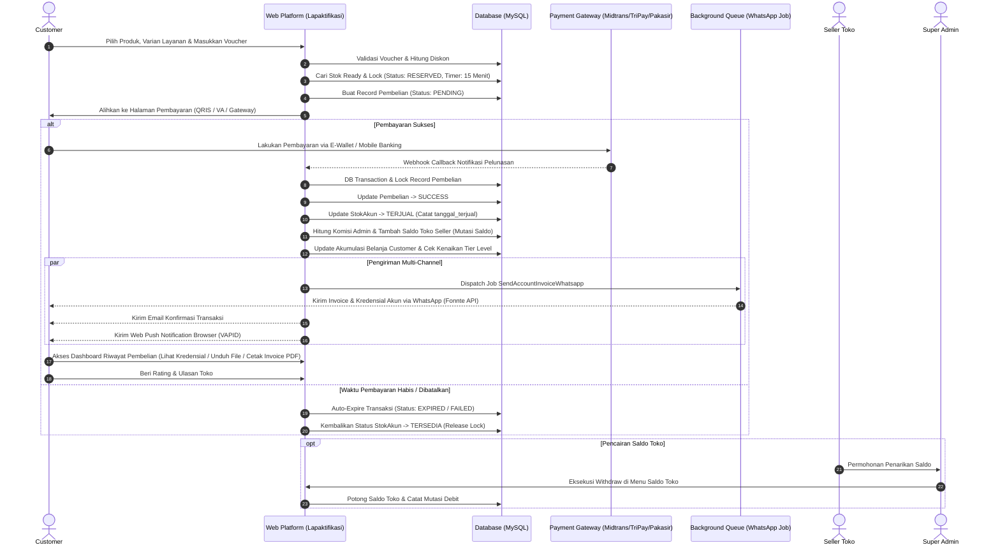

# 📘 Dokumentasi Lengkap & Spesifikasi Fitur Sistem Web Lapaktifikasi

**Lapaktifikasi** adalah platform *digital marketplace & e-commerce ekosistem terpadu* modern yang dirancang khusus untuk memfasilitasi transaksi jual-beli **Akun Layanan Premium** (seperti Spotify, Netflix, YouTube Premium, Canva Pro, ChatGPT Plus, Discord, dll) dan **Produk Berkas Digital** (seperti Source Code ZIP, Dokumen/E-Book, Modul Pembelajaran, Preset, dan Template Desain).

Platform ini mengintegrasikan ekosistem multi-peran (*multi-role architecture*) yang menghubungkan **Customer (Pembeli)**, **Seller (Mitra Toko)**, dan **Super Admin (Pengelola Platform)** dalam satu sistem yang aman, transparan, terotomatisasi secara *real-time*, serta dilengkapi integrasi WhatsApp Gateway, Web Push Notification, PWA, dan RESTful API mobile.

---

## 🏗️ 1. Arsitektur Sistem & Spesifikasi Teknologi

Sistem Lapaktifikasi dibangun di atas tumpukan teknologi (*technology stack*) modern dengan standar performa dan keamanan tinggi:

- **Framework Backend:** **Laravel 13.x** (PHP ^8.2 || ^8.3 || 8.4+) dengan arsitektur *Model-View-Controller* (MVC), Service Layer Pattern, dan Policy Authorization.
- **Frontend Engine & Komponen Dinamis:**
  - **Livewire v4.4:** Interaktivitas reaktif pada komponen dashboard dan pembaruan data real-time tanpa reload halaman penuh.
  - **Blade Templates:** Template modular terpisah per modul (*Landing, Dashboard Admin, Seller, Customer, Auth*).
  - **Modular CSS & Modern UI:** Struktur CSS modular (`base.css`, `navbar.css`, `footer.css`, `modal.css`, `animations.css`, dan page styles).
  - **Asset Bundler:** **Vite 4.x** + `laravel-vite-plugin`.
- **Database Management System:** MySQL Relasional (InnoDB) dengan integritas data berbasis *Foreign Key Constraints*, transaksi database atomik (`DB::transaction`), dan *Pessimistic Locking* (`lockForUpdate`).
- **Cache, Session & Queue Storage:** Redis (`predis/predis ^3.6`) & Database Queue Driver.
- **Autentikasi & Otorisasi:**
  - Web Session Multi-Auth dengan Middleware Role-Based Access Control (RBAC).
  - API Token Authentication menggunakan **Laravel Sanctum ^4.0**.
  - Login pihak ketiga (*Single Sign-On*) via **Google OAuth 2.0 (Laravel Socialite ^5.16)**.
  - Fitur wajib ganti password awal (*Must Change Password*) dan sistem proteksi pemblokiran akun (*Banned System* via `CheckBannedUser` middleware).
- **Payment Gateway Terintegrasi (Multi-Gateway Engine):**
  - **Midtrans Snap Engine (`midtrans/midtrans-php ^2.5`):** Pembayaran instan via QRIS (GoPay, ShopeePay, OVO, DANA), Virtual Account Bank (BCA, Mandiri, BNI, BRI, Permata), dan Kartu Kredit.
  - **TriPay Gateway:** Pembayaran multi-channel real-time dengan verifikasi signature HMAC-SHA256 serta scheduled auto-reconciliation.
  - **Pakasir Gateway:** Gateway pembayaran QRIS & merchant alternatif dengan monitoring kedaluwarsa transaksi otomatis.
  - *Dynamic Gateway Switcher:* Admin dapat mengaktifkan/menonaktifkan gateway tertentu kapan saja melalui panel admin (dengan validasi minimal 1 gateway aktif).
- **Background Queue & Notifikasi Otomatis:**
  - **WhatsApp API Gateway (Fonnte):** Queue Job (`SendAccountInvoiceWhatsapp`) untuk pengiriman invoice resmi, kredensial akun, dan tautan download langsung ke nomor WhatsApp customer seketika setelah pembayaran terkonfirmasi.
  - **Web Push Notifications:** Notifikasi browser native via Service Worker berstandar VAPID (`minishlink/web-push ^11.0`).
  - **Email Notification (SMTP/Mailpit):** Pengiriman email konfirmasi order dan detail transaksi format HTML responsif.
- **Progressive Web App (PWA):**
  - Dilengkapi manifest web standar (`manifest.json`), icon multi-resolusi, dan Service Worker native (`sw.js`) untuk pengalaman aplikasi *installable* di perangkat Android, iOS, maupun Desktop.
- **Generator Dokumen & Barcode:**
  - **DomPDF (`barryvdh/laravel-dompdf ^3.2`):** Auto-generate lembar invoice resmi format PDF berstandar komersial lengkap dengan rincian transaksi, kode order unik, dan status lunas.
  - **QR Code Engine (`simplesoftwareio/simple-qrcode ^4.2`):** Pembuatan barcode & QR Code dinamis untuk invoice dan transaksi.
- **Proteksi & Keamanan Data:**
  - Enkripsi dua arah kredensial akun (*Username/Email & Password*) pada database menggunakan *AES-256-CBC* (`Illuminate\Support\Facades\Crypt`). Password hanya didekripsi secara *on-demand* saat customer yang berhak mengaksesnya.
  - *Stock Lock Reservation Timer:* Penguncian stok selama 15 menit menggunakan countdown timer guna mencegah *double-booking* atau perebutan stok saat proses pembayaran berlangsung.
  - *Maintenance Mode Guard:* Saklar pemeliharaan platform menyeluruh yang dapat diaktifkan Super Admin dengan tampilan ramah pengguna.
  - *SEO & Rich Snippets Engine:* Schema.org `OnlineStore` & `FAQPage` JSON-LD, sitemap generator otomatis (`/sitemap.xml`), `robots.txt`, dan `llms.txt`.

---

## 👥 2. Matriks Peran & Hak Akses Pengguna (Role Breakdown)

Sistem membagi akses pengguna ke dalam 3 hierarki peran:

```
┌─────────────────────────────────────────────────────────────────────────┐
│                       LAPAKTIFIKASI ECOSYSTEM                           │
└────────────┬────────────────────────────┼───────────────────────────────┘
             │                            │                               
             ▼                            ▼                               ▼
  ┌───────────────────────┐   ┌───────────────────────┐       ┌───────────────────────┐
  │     SUPER ADMIN       │   │        SELLER         │       │       CUSTOMER        │
  │      (Role ID: 1)     │   │      (Role ID: 3)     │       │      (Role ID: 2)     │
  └───────────────────────┘   └───────────────────────┘       └───────────────────────┘
```

---

## 🟢 3. Fitur Lengkap Customer (Pelanggan / Pembeli) — Role 2

Customer adalah pengguna yang mendaftar untuk membeli akun premium, mengunduh aset produk digital, atau top up saldo dompet internal.

### 3.1. Eksplorasi Katalog & Toko Seller
1. **Katalog Produk Global (`/premium/katalog`):**
   - Menjelajahi seluruh produk yang berstatus aktif dari seluruh seller terverifikasi.
   - Filter instan berdasarkan Kategori Produk (`Semua`, `Akun Premium`, `File Digital`).
   - Fitur pencarian cepat berdasarkan kata kunci nama produk atau deskripsi produk.
   - Indikator harga terendah hingga tertinggi (*Price Range*), badge toko penjual, rating bintang rata-rata, dan total ulasan.
2. **Direktori Daftar Toko (`/daftar_toko`):**
   - Menampilkan seluruh etalase toko seller yang aktif dengan paginasi rapi.
   - Menampilkan logo toko, nama toko, badge reputasi toko (*Verified*, *Top Seller*, dll), dan deskripsi singkat toko.
3. **Katalog Toko Tertentu (`/toko/{slug}/produk`):**
   - Menampilkan katalog produk khusus yang hanya dijual oleh toko yang dipilih beserta profil lengkap toko tersebut.
4. **Halaman Detail Produk Interaktif (`/toko/{store_slug}/produk/{product_slug}`):**
   - **URL SEO-Friendly:** Format tautan ramah mesin pencari.
   - **Galeri Visual:** Menampilkan cover gambar utama produk beserta screenshot pendukung.
   - **Pemilih Tipe & Varian Layanan:** Memilih jenis paket (misal: *Private*, *Sharing*, *Family*) dan durasi hari (misal: *30 Hari*, *90 Hari*, *365 Hari*).
   - **Live Stock Checker:** Pengecekan sisa stok akun secara *real-time* via Ajax tanpa perlu merefresh halaman.
   - **Breakdown Ulasan & Rating Bintang:** Menampilkan distribusi rating (Bintang 1 sampai 5) dan riwayat testimoni ulasan dari pembeli terverifikasi sebelumnya.

### 3.2. Transaksi, Checkout, & Multi-Payment Gateway
1. **Validasi Profil Sebelum Checkout:**
   - Sistem mewajibkan Customer melengkapi Nama dan Nomor WhatsApp di profil terlebih dahulu sebelum dapat membuat pesanan, guna memastikan pengiriman kredensial akun berjalan sukses.
2. **Klaim & Penggunaan Voucher Diskon:**
   - Input kode kupon diskon langsung di halaman pesanan.
   - Sistem secara otomatis memvalidasi jenis voucher (Global atau Toko Spesifik), syarat minimal belanja, masa berlaku, dan kuota pemakaian.
   - Potongan harga langsung dihitung secara transparan (tipe persen maupun potongan nominal).
3. **Reservasi & Penguncian Stok (Stock Lock 15 Menit):**
   - Seketika tombol checkout ditekan, 1 stok akun akan diubah statusnya menjadi `RESERVED` dan dikunci untuk pesanan tersebut selama 15 menit.
   - Mencegah pembeli lain merebut stok yang sama saat customer sedang menyelesaikan pembayaran.
4. **Pemilihan Gateway & Saluran Pembayaran (`/metode_pembayaran/{order_id}`):**
   - **QRIS Instan:** Tampilan QR Code QRIS yang dapat di-scan oleh seluruh aplikasi e-wallet (GoPay, OVO, DANA, ShopeePay, LinkAja) dan Mobile Banking.
   - **Virtual Account (VA):** Nomor VA Bank BCA, Mandiri, BNI, BRI, Permata yang dapat disalin dengan mudah.
   - **Auto-Sync Polling:** Halaman status pembayaran secara cerdas memeriksa status pelunasan di background (`/api/status/{order_id}`) dan otomatis berpindah halaman begitu pembayaran lunas.

### 3.3. Akses Produk & Riwayat Pembelian (`/premium/riwayat`)
1. **Akses Kredensial Akun Instan (On-Demand Decryption):**
   - Begitu pembayaran terverifikasi LUNAS (`SUCCESS`), username/email dan password akun digital langsung muncul di dashboard customer.
   - Terdapat tombol *Copy Kredensial* dan instruksi/catatan khusus dari seller.
2. **Download File Digital Aman:**
   - Untuk produk kategori *File Digital*, customer mendapatkan tombol unduh file (.zip, .pdf, dll) yang diamankan dengan validasi hak kepemilikan transaksi.
3. **Unduh Lembar Invoice PDF Resmi:**
   - Cetak dan simpan invoice transaksi format PDF sewaktu-waktu sebagai bukti pembelian yang sah.
4. **Filter Rentang Tanggal Riwayat:**
   - Memfilter transaksi berdasarkan rentang tanggal tertentu atau pencarian kode Order ID.

### 3.4. Tiket Bantuan & Klaim Garansi (`/premium/laporan`)
- Fitur pelaporan kendala akun jika terjadi masalah selama masa garansi.
- Upload bukti screenshot kendala dan penjelasan kronologi.
- Tracking status tiket: `Pending` ➔ `Diproses` ➔ `Selesai`.

### 3.5. Dompet & Reward Loyalitas Customer
- **Member Tiering:** Level loyalitas pembeli (Bronze, Silver, Gold, Platinum) berdasarkan total akumulasi belanja.
- **Sistem Referral:** Link referral ajak teman untuk mendapatkan bonus reward reward komisi belanja.

---

## 🟡 4. Fitur Lengkap Seller (Mitra Penjual / Toko) — Role 3

Seller adalah mitra pedagang digital yang mengelola toko, mengupload produk, mengatur varian paket, menginput stok akun, dan mengelola pendapatan.

### 4.1. Dashboard Bisnis Seller (`/dashboard`)
- Statistik penjualan toko: Omzet harian/bulanan, total transaksi sukses, jumlah produk aktif, dan saldo toko siap tarik.
- Grafik analitik performa penjualan dan produk terlaris.

### 4.2. Manajemen Profil Toko (`/seller/toko`)
- Pengaturan nama toko, deskripsi toko, tautan media sosial, nomor layanan WhatsApp, dan domain/subdomain toko.
- Kustomisasi logo brand toko yang tampil di katalog publik, invoice, dan halaman detail produk.

### 4.3. Manajemen Produk Akun Premium (`/menu_produk`)
- Menambahkan produk akun premium (misal: *Netflix Premium UHD*, *Spotify Individual*).
- Upload cover thumbnail produk dengan kompresi visual optimal.
- Mengatur status tayang produk (`aktif` / `nonaktif`).
- **Sistem Proteksi Riwayat Transaksi:** Jika produk sudah memiliki riwayat penjualan, produk tidak dapat dihapus permanen untuk melindungi data pembeli lama, melainkan dinonaktifkan status tayangnya secara aman.

### 4.4. Manajemen Inventaris Tiga Tab (`/premium/inventaris`)
1. **Tab 1 — Tipe Layanan (`tbl_tipe_layanan`):**
   - Mengelompokkan jenis paket di bawah master produk (misal: *Private 1 Profile*, *Sharing 1 Device*).
2. **Tab 2 — Varian Layanan (`tbl_varian_layanan`):**
   - Mengatur durasi aktif akun dalam satuan hari (misal: *30 Hari*, *90 Hari*, *365 Hari*).
   - Menetapkan harga jual per varian.
   - Menambahkan catatan spesifikasi paket.
3. **Tab 3 — Inventaris Stok Akun Digital (`tbl_stok_akun`):**
   - **Input Satuan:** Form Email/Username, Password, dan Catatan Tambahan.
   - **Input Massal (*Bulk Import*):** Fitur input puluhan akun sekaligus dalam 1 kali klik format pipa:
     ```text
     email1@gmail.com|password123|Profil 1 PIN 1234
     email2@gmail.com|password456|Profil 2 PIN 5678
     ```
   - **Enkripsi Kredensial Otomatis:** Password dienkripsi AES-256 saat tersimpan di database.
   - **Show Password Modal:** Seller pemilik toko dapat meninjau password miliknya dengan aman.
   - **Siklus Status Stok:**
     - `TERSEDIA` : Stok siap dijual.
     - `RESERVED` : Stok dikunci sementara 15 menit oleh checkout customer.
     - `TERJUAL` : Stok lunas dan diserahkan ke pembeli.

### 4.5. Manajemen Produk & File Digital (`/menu_produk_digital` & `/digital/inventaris`)
- Mengelola berkas master digital (E-Book, Script Source Code, Template Grafis, Dokumen).
- Upload berkas master digital dengan validasi batas ukuran file (*file size limit*) sesuai konfigurasi platform.
- Akses berkas digital berlaku permanen seumur hidup (*lifetime access*) bagi pembeli.

### 4.6. Histori Penjualan & Laporan Keuangan Toko (`/premium/histori`)
- Memantau transaksi khusus toko seller dengan filter rentang tanggal.
- Data pembeli, status pembayaran, varian yang dibeli, dan komisi platform yang dipotong.

### 4.7. Manajemen Voucher Toko (`/seller/voucher`)
- Menerbitkan kupon promo eksklusif toko (`scope: toko_spesifik`).
- Opsi diskon persentase (%) atau potongan nominal (Rp).
- Syarat minimal belanja, kuota kupon, dan batas masa aktif.

### 4.8. Sistem Reputasi & Badge Toko (`/seller/badges`)
- Pelacakan syarat perolehan badge:
  - **Rating Minimal:** Rating rata-rata toko di atas 4.8 bintang.
  - **Lama Bergabung:** Bermitra lebih dari 30 / 90 / 180 hari.
  - **Volume Transaksi:** Menyelesaikan lebih dari 50 / 100 / 500 transaksi sukses.
  - **Custom Badge:** Lencana penghargaan langsung dari Super Admin.
- Tampilan kartu badge interaktif dengan *progress bar* capaian.

---

## 🔴 5. Fitur Lengkap Super Admin (Pengelola Platform) — Role 1

Super Admin memegang kendali tertinggi (*Full Privilege*) terhadap seluruh tata kelola ekosistem, moderasi, keuangan, dan pengaturan teknis website.

### 5.1. Dashboard Utama Platform (`/dashboard`)
- **Live Monitoring Platform:**
  - Total order masuk platform harian/bulanan.
  - Total omzet perputaran dana kotor & bersih platform.
  - Total akun dan file digital terjual.
  - Live feed tabel transaksi terbaru real-time.

### 5.2. Master Kontrol Produk & Inventaris Global
- Super Admin memiliki hak akses penuh untuk meninjau, menyunting, mencari, atau menonaktifkan seluruh produk dan stok dari semua seller tanpa batasan scoping toko.

### 5.3. Manajemen & Moderasi Seller (`/kelola_seller`)
1. **Pendaftaran Seller Baru:**
   - Admin dapat mendaftarkan akun seller baru secara langsung dengan nomor telepon dan akun Telegram.
   - Seller baru otomatis berstatus `must_change_password` untuk keamanan.
2. **Kustomisasi Komisi Override per Toko:**
   - Admin dapat mengatur potongan komisi khusus untuk toko tertentu (misal diskon komisi untuk seller VIP).
3. **Pemberian & Pembuatan Badge:**
   - Memasang (*attach*), mencabut (*detach*), atau membuat **Custom Badge** baru secara dinamis.
4. **Sanksi & Pemblokiran Toko / Seller (*Ban System*):**
   - Memblokir toko dan akun seller bermasalah dengan wajib mengisi alasan sanksi (*Banned Reason*).
   - Toko yang dibanned otomatis dinonaktifkan etalasenya dari publik dan menampilkan banner peringatan resmi.
   - Fitur *Unban* untuk memulihkan akses toko kembali normal.

### 5.4. Manajemen Customer Platform (`/kelola_customer`)
- Daftar lengkap seluruh customer terdaftar, total akumulasi belanja, tier level, nomor WhatsApp terverifikasi, dan data referral.
- Fitur *Banned & Unbanned Customer* untuk menghentikan akun yang terindikasi melakukan fraud.

### 5.5. Tata Kelola Keuangan & Pencairan Saldo Toko (`/saldo_toko`)
- Monitoring total saldo aktif seluruh seller.
- Audit trail mutasi keluar-masuk dana per toko secara terperinci.
- **Eksekusi Penarikan Dana (Withdraw):**
  - Pemrosesan penarikan saldo toko ke rekening bank seller.
  - Validasi ketat saldo mencukupi dan eksekusi di dalam database lock (`lockForUpdate`) untuk mencegah *race condition*.

### 5.6. Pengaturan Komisi, Limit File & Mode Maintenance (`/setting_komisi`)
- **Komisi Platform Default:** Mengatur persentase potongan komisi platform per transaksi global (misal: 10%).
- **Batas Ukuran Upload File Digital:** Menetapkan batas maksimum ukuran berkas digital seller dalam satuan Megabyte (MB).
- **Mode Maintenance Darurat Platform:** Saklar darurat satu tombol untuk mengunci akses seller dan customer saat sistem dalam pemeliharaan berkala, dengan tampilan *Maintenance Screen* interaktif.

### 5.7. Manajemen Laporan Masalah & Garansi (`/premium/laporan-admin`)
- Moderasi seluruh tiket keluhan customer dari semua toko.
- Meninjau bukti screenshot kendala pembeli.
- Mengubah status tiket (`pending` ➔ `proses` ➔ `selesai`) dan memfasilitasi mediasi ganti akun atau refund.

### 5.8. Monitoring Transaksi, Audit Trail, & Sinkronisasi Manual (`/premium/histori`)
- **Check Status Gateway:** Tombol sinkronisasi manual status transaksi langsung ke server gateway (Midtrans / TriPay / Pakasir) jika webhook mengalami keterlambatan jaringan.
- **Retry Notifikasi WhatsApp Manual:** Tombol kirim ulang invoice WhatsApp ke pembeli jika koneksi WhatsApp sempat gagal, lengkap dengan rate limiting 60 detik dan audit log di `tbl_pembelian_log`.

### 5.9. Manajemen Voucher Diskon Global (`/admin/voucher`)
- Menerbitkan kupon diskon promo resmi yang berlaku secara universal di seluruh platform (`scope: global`) atau memilih toko target tertentu.

### 5.10. Konfigurasi Website & Multi-Gateway Switcher (`/setting_website`)
- **Branding & Identitas:** Nama Website, Tagline Deskripsi, Email Kontak Resmi, Nomor WhatsApp CS, Alamat Kantor, Upload Logo, Favicon, dan Auth Hero Background.
- **Saklar Multi-Gateway:** Mengaktifkan / menonaktifkan Midtrans, TriPay, dan Pakasir secara mandiri dengan proteksi minimal 1 gateway aktif.

### 5.11. Manajemen Konten Landing Page (`/mitra_industri`, `/testimoni`, `/admin/news`)
- **Mitra Industri:** CRUD logo dan nama partner bisnis/instansi untuk *Brand Showcase* halaman depan.
- **Testimoni Pelanggan:** CRUD ulasan pelanggan pilihan, rating bintang, foto, dan profesi.
- **CMS Berita & Edukasi (News):** Publikasi artikel berita platform, panduan keamanan, dan rilis fitur untuk meningkatkan SEO organik.

---

## 💳 6. Alur Transaksi, Pemrosesan Pembayaran & Notifikasi

Berikut adalah diagram alur transaksi menyeluruh (*End-to-End Flow*) dari pemesanan hingga penyerahan akun:



---

## 🔒 7. Mekanisme Keamanan & Integritas Data

1. **Pessimistic Locking pada Reservasi Stok:**
   - Menggunakan query `lockForUpdate()` saat proses checkout untuk memastikan tidak ada dua customer yang mendapatkan kredensial akun digital yang sama secara bersamaan (*anti double-spend*).
2. **Auto-Release Expired Reservation:**
   - Setiap kali customer membuka halaman riwayat atau halaman pembayaran, sistem secara otomatis memeriksa transaksi berstatus `PENDING` yang telah melewati batas 15 menit, membatalkan transaksi tersebut, dan mengembalikan stok menjadi `TERSEDIA`.
3. **Enkripsi Kredensial Berstandar Industri:**
   - Password akun yang disimpan di database dienkripsi menggunakan *App Key Laravel* berstandar enkripsi *OpenSSL AES-256-CBC*. Data yang disimpan pada database tidak dapat dibaca jika terjadi kebocoran raw database.
4. **Audit Trail Log:**
   - Setiap perubahan status pesanan, percobaan retry WhatsApp, atau sinkronisasi gateway dicatat ke dalam tabel `tbl_pembelian_log` lengkap dengan sumber perubahannya (`webhook_midtrans`, `webhook_tripay`, `manual_admin`, dll).
5. **Rate Limiting & Throttle:**
   - Endpoint login diproteksi dari serangan *Brute Force* dengan rate limiter (`throttle:limit_login`).
   - Endpoint status polling API dibatasi maksimal 30 request per menit (`throttle:30,1`).
   - Tombol retry WhatsApp dibatasi jeda minimum 60 detik per transaksi.

---

## ⚙️ 8. Background Artisan Commands & Scheduled Tasks

Sistem dilengkapi sejumlah command otomatis yang didesain untuk berjalan via *Server Cron*:

1. **`php artisan seller:evaluate-badges`**
   - Memindai performa seluruh toko secara berkala: menghitung rating rata-rata, masa bermitra, dan volume transaksi sukses, lalu menyematkan badge reputasi secara otomatis.
2. **`php artisan tripay:reconcile`**
   - Melakukan rekonsiliasi otomatis transaksi TriPay yang statusnya menggantung (*pending*) dengan memanggil API TriPay untuk mencegah pesanan yang sudah lunas tidak terkirim akibat gangguan webhook.
3. **`php artisan pakasir:expire-transactions`**
   - Memeriksa transaksi Pakasir yang sudah melewati batas waktu pembayaran dan otomatis membatalkannya serta mengembalikan stok akun digital ke status `TERSEDIA`.
4. **`php artisan balance:repair`**
   - Command audit trail untuk merekonsiliasi total saldo toko dengan riwayat mutasi kredit/debit demi menjamin integritas pembukuan finansial platform.

---

## 🔌 9. Spesifikasi REST API V1 & Endpoint Webhook

Lapaktifikasi dilengkapi dengan endpoint RESTful API V1 untuk mendukung integrasi aplikasi mobile Android / iOS:

### 9.1. Webhook & Callback Gateway (Public Endpoints)
- `POST /api/callback` : Webhook notifikasi transaksi dari Midtrans.
- `POST /api/callback/tripay` : Webhook notifikasi transaksi dari TriPay (validasi signature HMAC-SHA256).
- `POST /api/callback/pakasir` : Webhook notifikasi transaksi dari Pakasir.

### 9.2. Autentikasi API (`/api/v1/auth`)
- `POST /auth/login` : Login pengguna & penerbitan Bearer Token Sanctum.
- `POST /auth/register` : Pendaftaran akun customer baru.
- `POST /auth/forgot-password` : Permohonan token reset password.
- `POST /auth/reset-password` : Pembaruan password via token.
- `POST /auth/logout` : Revoke token autentikasi (Protected).

### 9.3. Katalog Publik (`/api/v1`)
- `GET /toko` : Daftar toko seller aktif.
- `GET /toko/{id}/produk` : Katalog produk per-toko.
- `GET /katalog` : Katalog produk global dengan filter kategori & pencarian.
- `GET /produk/{id}` : Detail produk, tipe, dan varian.
- `GET /produk/varian/{id}/stok` : Cek ketersediaan stok varian secara real-time.

### 9.4. Fitur Customer API (Protected - `only.customer`)
- `POST /checkout` : Pembuatan order & penguncian stok.
- `POST /pembayaran/generate/{order_id}` : Generate token/snap pembayaran gateway.
- `GET /pembayaran/status/{order_id}` : Cek status pembayaran terkini.
- `GET /customer/member` : Data level tier & progress belanja.
- `GET /customer/referral` : Data referral & link ajak teman.
- `GET /customer/riwayat` : Riwayat transaksi customer.
- `GET /customer/kredensial/{order_id}` : Akses kredensial akun digital yang telah dibeli.
- `POST /customer/voucher/{id}/klaim` : Klaim voucher ke akun.
- `POST /customer/review/{order_id}` : Kirim ulasan & rating bintang.
- `GET /customer/laporan` & `POST /customer/laporan` : Tiket klaim garansi kendala akun.

### 9.5. Fitur Seller API (Protected - `only.seller`)
- `GET /seller/dashboard` : Ringkasan omzet, pesanan, dan saldo.
- `GET /seller/mutasi` : Riwayat mutasi kredit/debit saldo toko.
- `GET /seller/profil` & `POST /seller/profil` : Kelola profil toko.
- `GET /seller/badges` : Capaian lencana reputasi toko.
- `GET /seller/produk`, `POST /seller/produk`, `DELETE /seller/produk/{id}` : CRUD produk toko.
- `GET /seller/voucher`, `POST /seller/voucher`, `PUT /seller/voucher/{id}` : CRUD voucher toko.

### 9.6. Fitur Admin API (Protected - `admin.only`)
- `GET /admin/dashboard` : Statistik menyeluruh platform.
- `GET /admin/kelola-seller` & `POST /admin/kelola-seller/{id}/toggle-status` : Moderasi toko seller.
- `GET /admin/laporan` & `PUT /admin/laporan/{id}/status` : Moderasi tiket laporan masalah.
- `GET /admin/setting-komisi` & `POST /admin/setting-komisi` : Konfigurasi komisi & limit platform.
- `GET /admin/voucher`, `POST /admin/voucher`, `DELETE /admin/voucher/{id}` : CRUD voucher global.

---

## 🌐 10. Halaman Informasi Publik & Navigasi Utama

1. **Landing Page (`/`):**
   - Halaman depan modern yang menyajikan *Hero Section* (responsif rasio gambar 4:5 pas di bawah navbar), katalog unggulan, panduan cara pembelian, fitur jaminan garansi, showcase mitra industri terpercaya, FAQ interaktif, serta testimoni pembeli.
2. **Halaman Pendaftaran Menjadi Seller (`/daftar-jadi-seller`):**
   - Panduan lengkap, keuntungan berjualan, dan formulir pengajuan bagi calon mitra penjual baru.
3. **Halaman Kemitraan (*Join Partner*) (`/join-partner`):**
   - Informasi program kerja sama untuk komunitas, instansi pendidikan, dan tim pengembang (dukungan subdomain toko gratis).
4. **Halaman Berita & Artikel (`/news`):**
   - Portal edukasi dan berita resmi platform seputar produk digital, tips keamanan, dan pembaruan sistem.
5. **Kebijakan Privasi (*Privacy Policy*) (`/kebijakan-privasi`):**
   - Pernyataan resmi mengenai tata cara pengumpulan data, pengolahan nomor WhatsApp, dan perlindungan privasi pengguna.
6. **Syarat & Ketentuan Layanan (*Terms of Service*) (`/syarat-ketentuan`):**
   - Ketentuan transaksi, klausul masa garansi akun premium, kebijakan pengembalian dana (*refund policy*), dan kode etik penggunaan platform.
7. **Halaman Akun Terblokir (`/banned`):**
   - Halaman peringatan khusus bagi pengguna atau toko yang diblokir yang memuat penjelasan alasan sanksi dan tombol kontak bantuan.

---

## 🤖 11. Integrasi Bot Telegram & Sistem Tiket Percakapan Dua Arah

Platform Lapaktifikasi terintegrasi penuh dengan Telegram Bot API untuk notifikasi real-time, percakapan tiket dua arah (*two-way thread*), serta *wizard* pembuatan tiket langsung dari aplikasi Telegram:

### 11.1. Penautan Akun & Preferensi Saluran Notifikasi
- **Deep Linking Aman:** Token dibuat menggunakan `bin2hex(random_bytes(16))` dengan penyimpanan hash `sha256` dan kedaluwarsa 15 menit. URL format: `https://t.me/<BOT_USERNAME>?start=<TOKEN>`.
- **Kewajiban Seller:** Mitra seller baru wajib menautkan Telegram sebelum toko aktif tayang. Seller lama diberikan banner dan *grace period* penautan via cron job `php artisan seller:enforce-telegram`.
- **Preferensi Notifikasi Customer:** Pilihan kanal fleksibel pada profil & tiket (`auto` / `telegram` / `whatsapp`). Jika Telegram belum tertaut atau bot diblokir, sistem otomatis melakukan fallback ke WhatsApp (Fonnte).

### 11.2. Thread Percakapan Tiket (Website & Telegram)
- **Model & Skema:** `tbl_laporan_pesan` mencatat seluruh percakapan tiket dengan pelacakan peran (`customer`, `seller`, `admin`, `system`), sumber pesan (`web` vs `telegram`), lampiran berkas (gambar/PDF), dan `telegram_message_id`.
- **Sinkronisasi Dua Arah:**
  - Balasan dari website otomatis mengirimkan notifikasi ke pihak lawan di Telegram dengan tombol inline `[💬 Balas]` dan `[🌐 Buka di Website]`.
  - Balasan dari Telegram via direct reply (`reply_to_message`) ke pesan bot dicocokkan otomatis melalui `tbl_telegram_message_map (chat_id, telegram_message_id)`.
  - Tombol `[💬 Balas]` pada notifikasi Telegram membuka sesi balas aktif (`tbl_telegram_sessions`, flow `balas`, 15 menit).
- **Pelacakan SLA & Respon Pertama:** `first_response_at` terisi otomatis saat seller/admin mengirimkan respon pertama mereka, dan status tiket berpindah dari `pending` ke `proses`.

### 11.3. Wizard `/lapor` pada Telegram
- Khusus bagi customer yang telah menautkan akun.
- Menampilkan hingga 8 pesanan berstatus `SUCCESS` yang masih dalam masa garansi (dihitung dari `tbl_pembelian.created_at + tbl_varian_layanan.durasi_hari`).
- Pilihan 5 kategori kendala standar:
  1. *Akun Tidak Bisa Login*
  2. *Akun Terkena Limit / Penuh*
  3. *Langganan Turun / Back to Free*
  4. *File Digital Rusak / Tidak Bisa Akses*
  5. *Masalah Lainnya*
- Pengisian teks kronologi detail dan unggah screenshot/foto bukti kendala (opsional, tersedia tombol `Lewati Foto`).
- Konfirmasi ringkasan laporan dan pembuatan tiket instan via `LaporanService` (aturan validasi dan perhitungan SLA terpadu dengan formulir web).

### 11.4. Perintah Bot Telegram
- `/lapor` : Memulai wizard pelaporan kendala pesanan garansi.
- `/tiket` : Menampilkan ringkasan tiket aktif (`pending`, `proses`) dan 5 tiket terakhir yang telah selesai beserta status dan tautan ke website.
- `/batal` : Membatalkan sesi laporan atau sesi balasan aktif kapan saja.
- `/start` : Memulai bot atau memproses token penautan akun.
- `/putus` : Memutuskan tautan akun Telegram dari Lapaktifikasi dengan konfirmasi tombol.
- `/bantuan` : Menampilkan daftar perintah yang tersedia.

### 11.5. Keamanan & Pembatasan Frekuensi (Rate Limiting)
- **Filter Kredensial Akun:** Sistem memeriksa seluruh teks yang dikirimkan ke bot Telegram melalui pencocokan ekspresi reguler (*regex*). Jika terdeteksi memuat kata sandi (`password`, `pass`, `kata sandi`, format `email:password`), pesan **tidak disimpan** dan pengguna langsung diberi peringatan keamanan.
- **Rate Limiting Tiket:** Dibatasi maksimal 3 tiket baru per jam per customer (`laporan_create:{userId}`).
- **Rate Limiting Chat:** Dibatasi maksimal 20 pesan per menit per chat (`telegram_msg:{chatId}`).

### 11.6. Tombol Aksi Interaktif Seller & Admin Telegram (`lp:{id}:{aksi}`)
- **Format Callback Ringkas:** Menggunakan string format pendek berukuran kurang dari 64 byte (contoh: `lp:{laporan_id}:{aksi}`) untuk mematuhi batas spesifikasi Telegram Bot API:
  - `lp:{id}:ambil` : Mengambil alih penanganan tiket (`assigned_to = user_id`, status berpindah ke `proses`, pengisian `first_response_at`).
  - `lp:{id}:mintainfo` : Membuka sesi Telegram interaktif (`flow='balas'`, `action='mintainfo'`) di mana pesan teks/lampiran seller berikutnya akan diteruskan langsung ke customer.
  - `lp:{id}:ganti` : Pengiriman akun pengganti aman. **Dilarang keras meminta kredensial di chat Telegram**; bot membalas dengan tombol URL aman langsung menuju formulir dashboard seller web untuk memilih stok akun pengganti dari inventory.
  - `lp:{id}:selesai` / `lp:{id}:tutup` : Menyelesaikan tiket masalah, memperbarui status tiket, dan mengirimkan notifikasi ajakan pemberian ulasan produk ke customer.
  - `lp:{id}:tetapkan` : Aksi admin untuk menetapkan tiket secara langsung ke seller pemilik toko dari pesanan/produk terkait.
  - `lp:{id}:status_proses` : Memindahkan status tiket menjadi `proses`.
- **Validasi Server-Side Ketat:**
  - Memverifikasi pengirim (`from.id` / `chat.id`) cocok dengan akun pengguna yang tertaut di database.
  - Validasi hak akses role (hanya customer pemilik tiket, seller toko terkait, atau super admin).
  - Validasi siklus hidup: menolak eksekusi aksi bila status tiket sudah `selesai`.
  - Memberikan umpan balik instan melalui `answerCallbackQuery` dan memperbarui tampilan pesan secara dinamis menggunakan `editMessageText` (menampilkan badge status terbaru dan menyembunyikan tombol yang sudah tidak relevan).

### 11.7. Eskalasi Forum Topic Grup Admin & Monitoring SLA 5 Menitan
- **Eskalasi ke Supergroup Admin:**
  - Dilakukan secara idempoten (pencegahan duplikasi via kolom `escalated_at`).
  - Membuat Forum Topic baru di Supergroup Admin (`TELEGRAM_ADMIN_GROUP_ID`) via API `createForumTopic` dengan nama topik format `#<NO_TIKET> - <NAMA_TOKO>`.
  - ID topik disimpan pada `tbl_laporan.telegram_topic_id`.
  - Pesan ringkasan kendala dan tombol interaktif admin (`lp:{id}:ambil`, `lp:{id}:tetapkan`, `lp:{id}:status_proses`, `lp:{id}:selesai`) dikirimkan langsung ke topic tersebut menggunakan opsi `message_thread_id`.
- **Dua Arah di Forum Topic:** Pesan, instruksi, atau tanggapan yang dikirimkan admin di dalam topic tiket Telegram secara otomatis dicatat ke `tbl_laporan_pesan` (`sumber='telegram'`, `sender_role='admin'`) dan disinkronkan ke thread tiket customer serta seller.
- **Monitoring SLA Terjadwal (`php artisan laporan:check-sla`):**
  - Berjalan otomatis setiap 5 menit via Laravel Task Scheduling (`routes/console.php`).
  - Waktu SLA respon diambil dari pengaturan platform `setting_websites.sla_respon_jam` (default 3 jam).
  - **Pengingat Seller:** Mengirimkan notifikasi peringatan ke Telegram seller 60 menit sebelum `sla_due_at` (idempoten via `sla_reminder_sent_at`).
  - **Eskalasi Otomatis:** Jika tiket berstatus `pending` melewati batas `sla_due_at` tanpa respon dari seller, sistem secara otomatis mengekskalasi tiket ke Forum Topic grup Admin.

### 11.8. Audit Trail Perubahan Status Tiket (`tbl_laporan_log`)
- Seluruh perubahan status tiket dicatat secara terpusat pada tabel `tbl_laporan_log` (mengikuti arsitektur `tbl_pembelian_log`) dengan struktur:
  - `id_log` (PK auto-increment)
  - `laporan_id` (FK ke `tbl_laporan`)
  - `user_id` (FK nullable ke `users`)
  - `status_lama` & `status_baru` (`pending`, `proses`, `selesai`, `dibatalkan`)
  - `sumber_perubahan` (`telegram_customer`, `telegram_seller`, `telegram_admin`, `web_customer`, `web_seller`, `web_admin`, `system_sla`)
  - `keterangan` (deskripsi kontekstual aksi)
  - `timestamps` (`created_at`, `updated_at`)

---

*Dokumen ini merupakan spesifikasi teknis dan dokumentasi fungsional resmi sistem Lapaktifikasi Web Application.*
